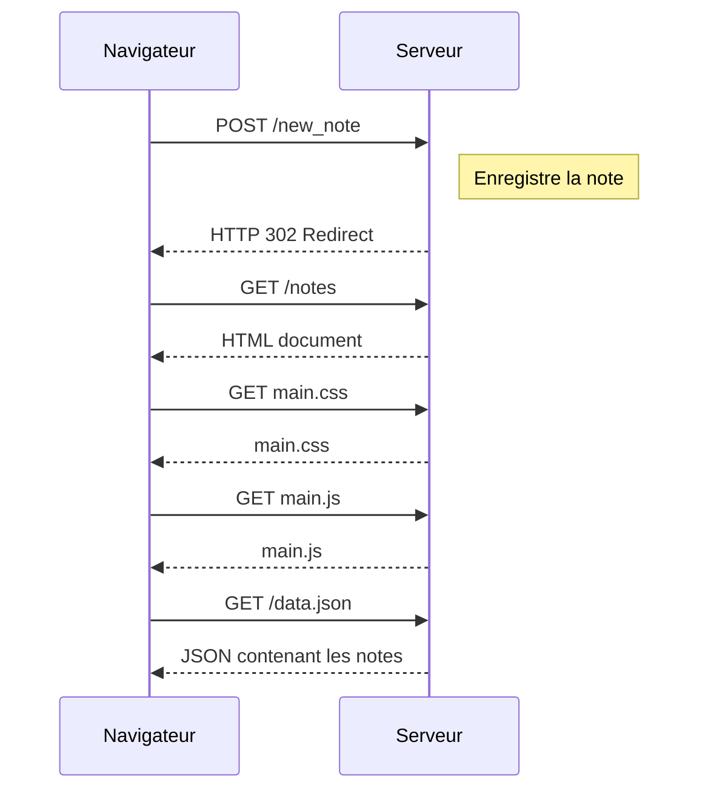

# Exercice 0.4 — Nouvelle note

## Diagramme de séquence

## Explication

1. Le navigateur envoie la note avec une requête POST.
2. Le serveur enregistre la note et redirige le navigateur.
3. Le navigateur demande la page des notes.
4. Il charge les ressources CSS et JavaScript.
5. Le JavaScript récupère les notes au format JSON.
6. Le navigateur affiche la liste mise à jour.

