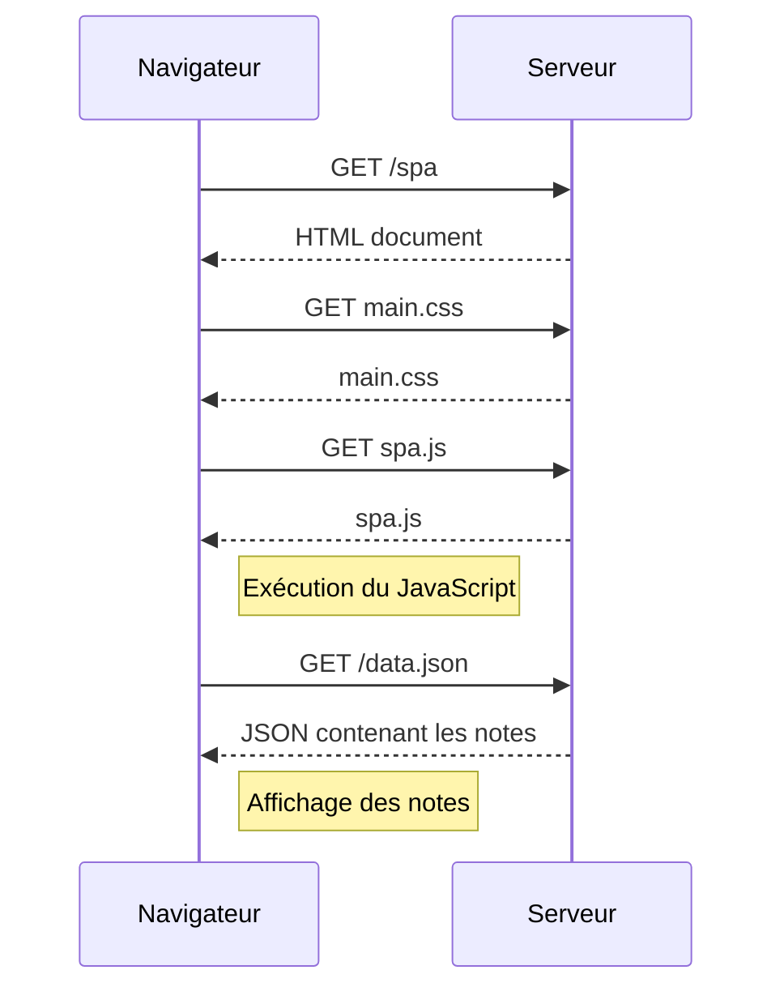

# Exercice 0.5 — Application à page unique (SPA)

## Diagramme de séquence

## Explication

1. Le navigateur charge le document HTML de la SPA.
2. Il récupère le CSS et le fichier JavaScript.
3. Le JavaScript demande les notes au serveur.
4. Le serveur renvoie les données JSON.
5. Le JavaScript affiche les notes dans la page.
