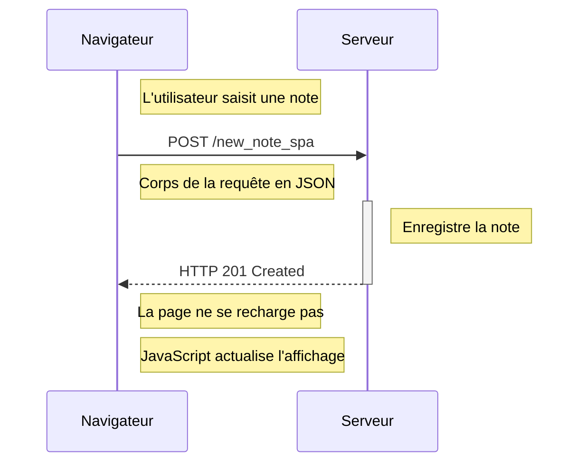

# Exercice 0.6 — Nouvelle note dans une SPA

## Diagramme de séquence

## Explication

1. L'utilisateur saisit une note.
2. JavaScript intercepte la soumission du formulaire.
3. Le navigateur envoie une requête POST contenant les données JSON.
4. Le serveur enregistre la note et renvoie une réponse de succès.
5. JavaScript actualise l'affichage sans recharger le document HTML.
